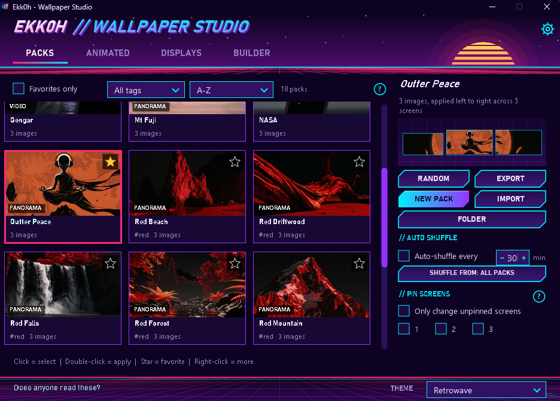
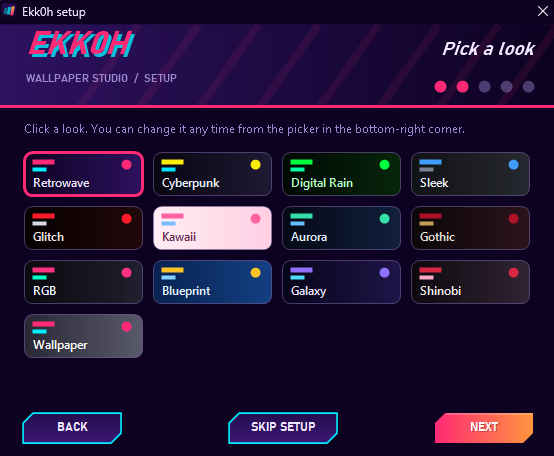
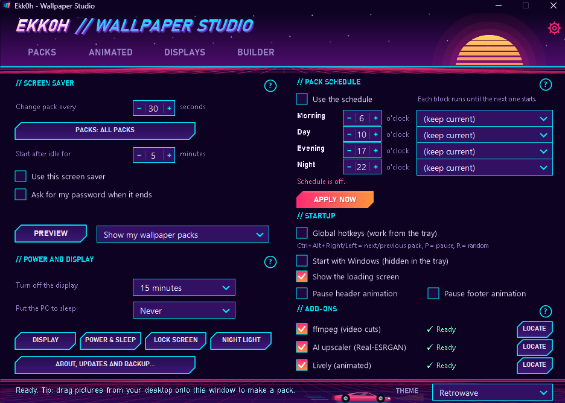

# Ekk0h - Wallpaper Studio

Turn folders of pictures into wallpaper packs that spread across all of your monitors, switch between them in one click, and wear one of thirteen themes while you do it.



## What it does

- **Wallpaper packs.** Drop pictures onto the window and get a pack. Each pack is split across every screen, sized to fit each one.
- **Builder.** Arrange, crop and align pictures per monitor before you apply them. Optional AI upscaler for small images.
- **Video and live wallpapers.** Cut one video across all of your screens (needs ffmpeg), or run live wallpapers through Lively.
- **Schedule.** Change pack on a timer, at logon, or by hand. Global hotkeys and a tray menu keep it out of the way.
- **Screen saver.** Plays your packs full screen, or runs an animation that matches your theme: starfield, digital rain, neon pipes, drafting sheet and more.
- **Thirteen themes.** Retrowave, Cyberpunk, Digital Rain, Sleek, Glitch, Kawaii, Aurora, Gothic, RGB, Blueprint, Galaxy, Shinobi, and Wallpaper (colors taken from your desktop). Each has its own loading screen, header and footer animation.
- **First-run setup.** A short wizard picks your look, offers the optional add-ons and sets startup options.



## Install

1. Download the latest zip from the [Releases](../../releases) page and extract it anywhere you like.
2. Run `Ekk0h.exe`. The first launch opens the setup wizard.

Keep `Ekk0h.exe`, `Ekk0h.ps1`, `Ekk0h.scr` and `ControlCenter.ico` in the same folder. Your packs and settings are stored there too.

**Requirements:** Windows 10 or 11 with Windows PowerShell 5.1 (included with Windows). Nothing else is needed.

### A note on antivirus

The exe is unsigned and starts the PowerShell script inside itself, which some antivirus programs treat with suspicion. If Windows Defender blocks it, check its protection history, restore the file and add the folder as an exclusion. The full source is in this repository, so you can read it or build it yourself.

## Optional add-ons

These are never required. Settings > Add-ons (and the setup wizard) can download and set up the first two for you.

| Add-on | Gives you |
|---|---|
| ffmpeg | Cut one video across your screens |
| Real-ESRGAN upscaler | AI upscaling in the Builder |
| Lively Wallpaper | Live wallpapers (installed separately) |

See [THIRD-PARTY-NOTICES.md](THIRD-PARTY-NOTICES.md) for their licenses.

## Hotkeys

| Keys | Action |
|---|---|
| Ctrl+Alt+Right / Left | Next / previous pack |
| Ctrl+Alt+P | Pause or resume live wallpapers |
| Ctrl+Alt+R | Random pack |

Hotkeys can be turned off in the main window.

## Screen saver

Open Settings > Screen saver, tick "Use this screen saver", and choose what it shows: your wallpaper packs, or an animation matching your theme. Preview shows it right away. The Wallpaper theme has no animation, so it keeps showing your packs.



## Build from source

You need nothing but Windows. In the project folder run:

```
Build-Exe.bat
```

It compiles `Launcher.cs` into `Ekk0h.exe` and `ScreenSaver.cs` plus `ThemeSaver.cs` into `Ekk0h.scr` using the C# compiler that ships with .NET Framework. The app itself is `Ekk0h.ps1`; edit it and restart to see changes. `Build-Exe.bat embed` builds a single-file exe with the script inside, but antivirus programs dislike that form more.

## Files

| File | Purpose |
|---|---|
| `Ekk0h.ps1` | The application (PowerShell + WinForms) |
| `Launcher.cs` | Exe that hosts the script and draws the loading screens |
| `ScreenSaver.cs`, `ThemeSaver.cs` | The screen saver |
| `Build-Exe.bat` | Builds the exe and screen saver |
| `settings.json`, `packmeta.json` | Created at run time: your options and pack info |

## License

[MIT](LICENSE). Third-party programs keep their own licenses.
